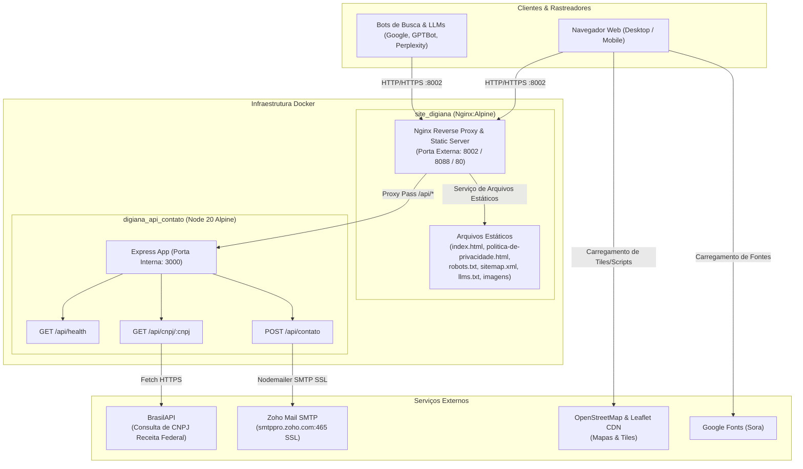

# Estudo Arquitetural e de Engenharia de Software — Site Oficial Digiana

---

## 1. Visão Geral do Projeto

O **Site Oficial da Digiana** ([digiana.com.br](https://digiana.com.br)) é uma plataforma web institucional concebida para posicionar a marca como um **Ecossistema de Inteligência Empresarial**, integrando:
- Contabilidade e Fiscal Consultivos;
- Controladoria Estratégica e Finanças Corporativas;
- BPO Financeiro;
- Ciência de Dados, BI e Tecnologia de Negócios;
- Inteligência Artificial para Validação e Tomada de Decisão;
- Especialização setorial em Saúde (clínicas, hospitais, laboratórios e operadoras).

Além de atuar como portal de presença digital de alta conversão para captação de leads qualificados (B2B), a aplicação implementa engenharia de ponta voltada a **SEO tradicional** e **GEO (Generative Engine Optimization)**, permitindo indexação e citação precisas por motores de busca e modelos de linguagem generativa (OpenAI ChatGPT, Google Gemini/AI Overviews, Perplexity, Anthropic Claude).

---

## 2. Arquitetura da Solução & Topologia dos Serviços

A solução adota uma arquitetura em microsserviços conteinerizada, composta por um gateway reverso/servidor estático (**Nginx**) acoplado a um microsserviço de backend (**Node.js/Express**), encapsulados via Docker Compose e integrados a redes corporativas isoladas.



---

## 3. Detalhamento dos Componentes

### 3.1. Frontend (`index.html` e `politica-de-privacidade.html`)
- **Abordagem de Construção:** Desenvolvido no padrão *Zero-Build Standalone*, contendo CSS, vetores SVG inline, JavaScript puro (Vanilla ES6+) e fontes incorporadas diretamente nos documentos HTML. Essa estratégia elimina a dependência de pipelines complexos de build (Webpack, Vite, Rollup) para entrega em produção, garantindo carregamento instantâneo, portabilidade e baixíssimo consumo de I/O de disco.
- **Recursos de UI/UX e Interatividade:**
  - **Stacking Cards Animados:** Implementado via script customizado (`all-cards-stack-script`), gerando efeito de empilhamento gradual com controle de escala (`scale`), desfoque (`blur`) e visibilidade durante a rolagem em telas mobile/tablets (< 1024px).
  - **Marquee Contínuo:** Script de rolagem horizontal contínua e infinita de logomarcas/parceiros (`sandra-scroll-script`).
  - **Navegação Adaptativa:** Barra de navegação flutuante (*pill design*) com suporte a *safe-area-inset* para iOS/Android e menu retrátil para telas menores que 860px.
  - **Geolocalização & Mapas:** Integração com [Leaflet.js](https://unpkg.com/leaflet@1.9.4/dist/leaflet.js) e tiles do OpenStreetMap estilizados em escala de cinza com pin personalizado com a identidade visual da Digiana.
  - **Formulário Reativo e Inteligente:**
    - Custom Dropdowns Estilizados (*Situação da empresa*, *Segmento* e *Assunto*): 100% incorporados à identidade visual da Digiana (fundo Azul Marinho `#02254D`, tipografia Sora, realce em Verde Oceano `#18A39E`, setas dinâmicas animadas e transição fluida de abertura com slide-down e fade-in).
    - Barra suspensa de intenção (*Situação da empresa*): permite selecionar entre "Empresa possui CNPJ" e "Abertura de empresa".
    - Modo CNPJ: exibe dinamicamente os campos de CNPJ e Razão Social; ao digitar o CNPJ (com debounce de 300ms), consome `/api/cnpj/:cnpj` preenchendo automaticamente Nome Empresarial, E-mail oficial e Telefone comercial (mantendo-os 100% editáveis pelo usuário).
    - Modo Abertura de Empresa: oculta os campos de CNPJ e Razão Social, seleciona automaticamente o assunto correspondente ("Abertura e legalização") e direciona para a coleta direta de contatos.
    - Máscaras automáticas de entrada para CNPJ e Telefone/WhatsApp.
    - Submissão assíncrona via `fetch` para `/api/contato` com envio do tipo de solicitação, desabilitação de botão e exibição de estados (enviando, sucesso, erro).
- **Adequação Regulatória (LGPD):**
  - Checkbox obrigatório de consentimento no formulário de contato.
  - Página dedicada de Política de Privacidade ([`politica-de-privacidade.html`](file:///C:/Users/edilson.monteiro/Documents/projetos/site_oficial/politica-de-privacidade.html)), cobrindo detalhadamente bases legais, direitos dos titulares, uso de cookies e canais do DPO/Encarregado.

### 3.2. Otimização SEO, GEO e Metadados para IA Generativa
O projeto conta com uma estrutura refinada para motores de busca modernos e assistentes generativos:
- **Schema.org (JSON-LD):** Gráfico estruturado de entidades (`Organization`, `AccountingService`, `ProfessionalService`, `PostalAddress`, `GeoCoordinates`, `OfferCatalog`), categorizando minuciosamente cada linha de serviço prestada.
- **Tags Geográficas e Metadados:** Definição estrita de coordenadas geográficas (`-12.9724334, -38.5137938`), `geo.region` (BR-BA), `geo.placename` (Salvador), OpenGraph e Twitter Cards.
- **Rastreadores LLM ([`robots.txt`](file:///C:/Users/edilson.monteiro/Documents/projetos/site_oficial/robots.txt)):** Liberação explícita de indexação para robôs de IA: `Google-Extended`, `GPTBot`, `ChatGPT-User`, `PerplexityBot`, `ClaudeBot`, `anthropic-ai` e `Applebot`.
- **Contexto Sintético para Modelos ([`llms.txt`](file:///C:/Users/edilson.monteiro/Documents/projetos/site_oficial/llms.txt)):** Arquivo padrão emergente de contexto semântico resumido, descrevendo missão, catálogo de serviços e canais oficiais da Digiana para consumo direto por agentes de IA.
- **Mapa do Site ([`sitemap.xml`](file:///C:/Users/edilson.monteiro/Documents/projetos/site_oficial/sitemap.xml)):** Indexação das URLs canônicas da raiz e da política de privacidade.

### 3.3. Microsserviço de Backend (`api/server.js`)
- **Tecnologias:** Node.js (v20 Alpine), Express 4, Nodemailer 6, Cors, Dotenv.
- **Camada de Endpoints:**
  - `GET /health` / `GET /api/health`: Monitoramento de disponibilidade e health check do contêiner.
  - `GET /api/cnpj/:cnpj`: Consulta a dados cadastrais na Receita Federal via BrasilAPI (`https://brasilapi.com.br/api/cnpj/v1/{cnpj}`), com sanitização de caracteres não-numéricos, timeout estrito de 7 segundos (`AbortController`) e normalização do retorno.
  - `POST /api/contato`: Recepção das mensagens do formulário institucional.
    - Validação de entrada: nome, empresa, e-mail (com validação sintática básica), telefone e flag de consentimento LGPD.
    - Sanitização XSS: função utilitária `escapeHtml` para evitar injeção de código HTML nas mensagens enviadas.
    - Despacho SMTP: integração com servidor corporativo Zoho Mail (`smtppro.zoho.com` na porta 465 SSL).
    - Montagem de e-mail estilizado com layout responsivo nas cores da marca (`#02254D` e `#00BA96`).
    - Configuração de cabeçalho `Reply-To` direto para o e-mail do lead, agilizando o retorno comercial pela equipe da Digiana.

---

## 4. Configuração de Infraestrutura e DevOps

### 4.1. Nginx Gateway ([`nginx.conf`](file:///C:/Users/edilson.monteiro/Documents/projetos/site_oficial/nginx.conf))
- **Gzip Compression:** Compressão nível 6 ativada para tipos MIME de texto, json, scripts, estilos, svg e woff2.
- **Políticas de Segurança (HTTP Headers):**
  - `X-Frame-Options: SAMEORIGIN` (mitigação de Clickjacking);
  - `X-Content-Type-Options: nosniff` (mitigação de MIME type sniffing);
  - `X-XSS-Protection: 1; mode=block`;
  - `Referrer-Policy: no-referrer-when-downgrade`.
- **Roteamento de API (Reverse Proxy):**
  - Todas as chamadas para `/api/` são encaminhadas internamente para o contêiner `http://api:3000`.
- **Políticas de Cache:**
  - Ativos estáticos (`.ico`, `.png`, `.jpg`, `.css`, `.js`, `.woff2`) possuem expiração configurada para 6 meses com `immutable`.

### 4.2. Docker e Orquestração ([`docker-compose.yml`](file:///C:/Users/edilson.monteiro/Documents/projetos/site_oficial/docker-compose.yml))
A composição define dois serviços interdependentes:
1. `site-digiana`:
   - Imagem base: `nginx:alpine`.
   - Mapeamento de porta: `${SITE_PORT:-8002}:80` (permitindo parametrização ágil entre ambiente local 8085/8088 e produção 8002).
   - Volumes montados como leitura (`:ro`) para facilidade de atualização a quente de arquivos estáticos.
2. `api`:
   - Imagem base: construída a partir de [`api/Dockerfile`](file:///C:/Users/edilson.monteiro/Documents/projetos/site_oficial/api/Dockerfile) (`node:20-alpine`).
   - Carregamento de variáveis de ambiente do arquivo [`.env`](file:///C:/Users/edilson.monteiro/Documents/projetos/site_oficial/.env).
3. **Rede:** Conexão à rede interna padrão (`default`) e à rede Docker compartilhada `digiana_digiana_network` (definida como externa), permitindo comunicação com outros serviços do ecossistema Digiana instalados no mesmo host.

---

## 5. Mapeamento Estrutural do Repositório

```
site_oficial/
├── .env.example                     # Modelo de variáveis de ambiente para SMTP e portas
├── .env                             # Arquivo de configuração local/produção (ignorado no Git)
├── .gitignore                       # Diretivas de exclusão do controle de versão
├── .dockerignore                    # Diretivas de exclusão do build de imagens Docker
├── Dockerfile                       # Imagem Nginx Alpine para servir o frontend e arquivos estáticos
├── docker-compose.yml               # Orquestrador multi-serviço (site + api)
├── nginx.conf                       # Configuração do servidor web e proxy reverso
├── index.html                       # Página principal institucional (Single Page, CSS/JS integrados)
├── Digiana_Empresarial_identidade_1.html # Cópia idêntica / backup histórico da página principal
├── politica-de-privacidade.html     # Política de Privacidade e Proteção de Dados (LGPD)
├── robots.txt                       # Diretivas de rastreamento para Web crawlers e agentes de IA
├── sitemap.xml                      # Mapa do site para indexação de motores de busca
├── llms.txt                         # Documento de contexto semântico padronizado para LLMs
├── LEIA-ME-PUBLICACAO.md            # Manual de publicação, orientações e histórico da entrega
├── README.md                        # Documento introdutório de execução rápida
├── favicon.ico                      # Ícone do site para navegadores legados
├── favicon.png                      # Ícone de alta resolução para navegadores modernos
├── DigiAna - Icone.png              # Ativo de imagem da identidade visual
└── api/                             # Microsserviço de Backend
    ├── Dockerfile                   # Imagem Node.js 20 Alpine
    ├── package.json                 # Manifesto de dependências (express, nodemailer, cors, dotenv)
    └── server.js                    # Servidor Express com endpoints de CNPJ, Contato e Health
```

---

## 6. Análise de Qualidade, Riscos e Recomendações de Engenharia

| Aspecto | Diagnóstico Atual | Recomendação do Arquiteto |
| :--- | :--- | :--- |
| **Arquitetura de Código Frontend** | `index.html` possui mais de 1300 linhas, acumulando HTML, estilos CSS globais e múltiplos blocos `<script>`. | Manter para deploys ultraleves estáticos, mas considerar para manutenções futuras modularizar o CSS e os scripts em arquivos separados (`/assets/css` e `/assets/js`) para facilitar versionamento e revisões pontuais. |
| **Resiliência e Segurança da API** | A rota de envio de contato (`/api/contato`) e consulta de CNPJ (`/api/cnpj`) não possuem mecanismo de *Rate Limiting*. | Adicionar o pacote `express-rate-limit` no Express para prevenir abusos de força bruta e esgotamento de cotas de envio SMTP ou bloqueios na BrasilAPI. |
| **Tratamento de Dados de Contato** | O envio de e-mails via Nodemailer depende da disponibilidade síncrona do servidor Zoho Mail. | Adicionar retry com fallback ou log estruturado em arquivo/banco leve para garantir que nenhum lead comercial seja perdido caso o servidor SMTP enfrente instabilidade pontual. |
| **Links Pendentes / Negócio** | O link de "Área do cliente" no menu principal aponta para `#contato` (comportamento registrado no manual de entrega). | Assim que o domínio ou subdomínio final do portal do cliente for disponibilizado, atualizar a referência no menu superior e no rodapé. |
| **Limpeza de Arquivos Legados** | O arquivo `Digiana_Empresarial_identidade_1.html` é um espelho exato de `index.html`. | Pode ser arquivado ou removido da imagem do contêiner para manter a base enxuta e evitar confusões de edição acidental. |

---

## 7. Procedimentos de Operação e Execução

### 7.1. Execução com Docker Compose (Recomendado)
1. Certifique-se de que a rede externa existe (caso utilize a rede compartilhada):
   ```bash
   docker network create digiana_digiana_network
   ```
2. Configure as credenciais no arquivo `.env`:
   ```bash
   cp .env.example .env
   # Editar .env e fornecer SMTP_USER, SMTP_PASS e a porta desejada (ex: SITE_PORT=8002)
   ```
3. Construa e suba os contêineres:
   ```bash
   docker compose up -d --build
   ```
4. Valide o funcionamento:
   - Site: `http://localhost:8002` (ou porta configurada)
   - Healthcheck da API: `http://localhost:8002/api/health`

### 7.2. Execução Local de Desenvolvimento (Sem Docker)
- **Frontend:**
  ```bash
  python3 -m http.server 8088
  ```
- **Backend:**
  ```bash
  cd api
  npm install
  npm start
  ```
